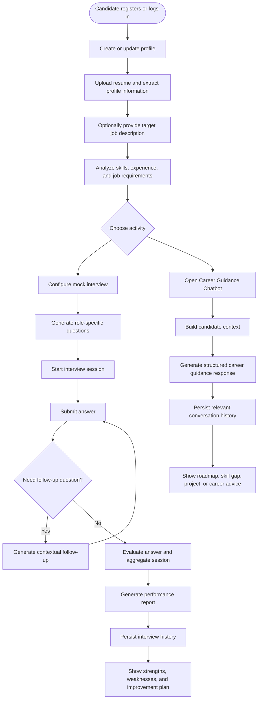
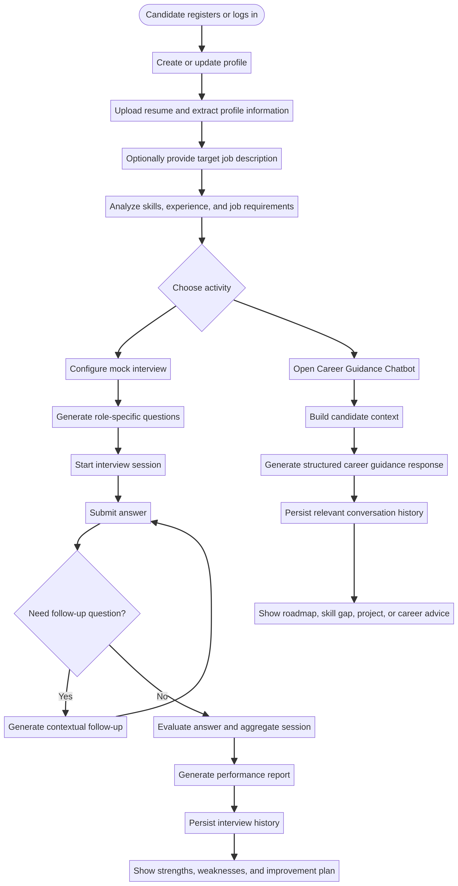
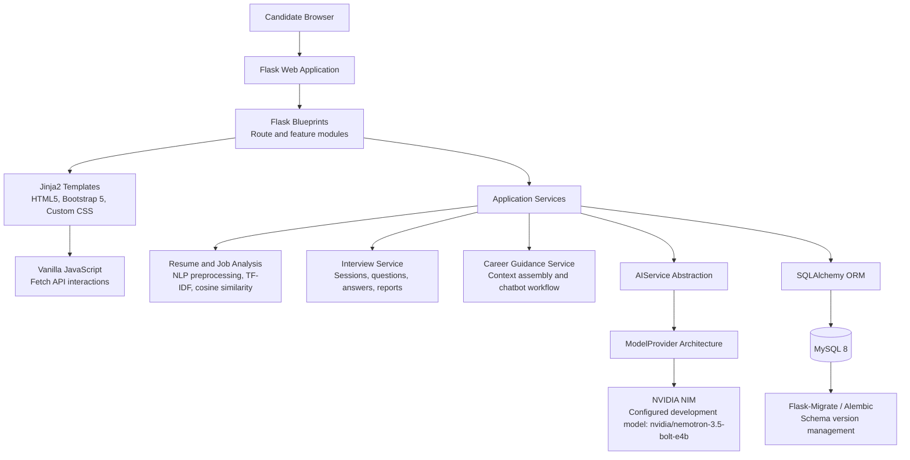
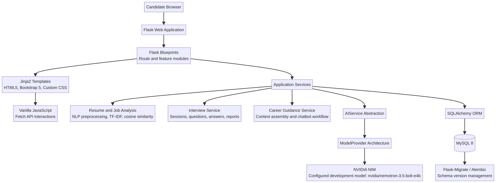
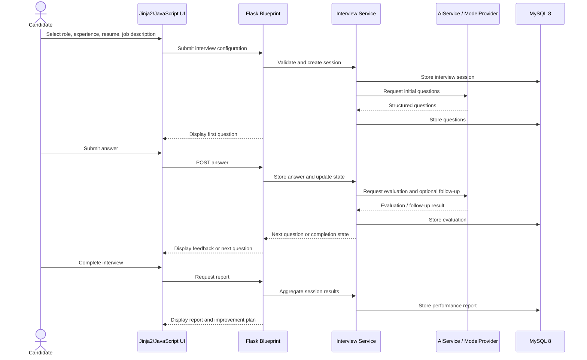
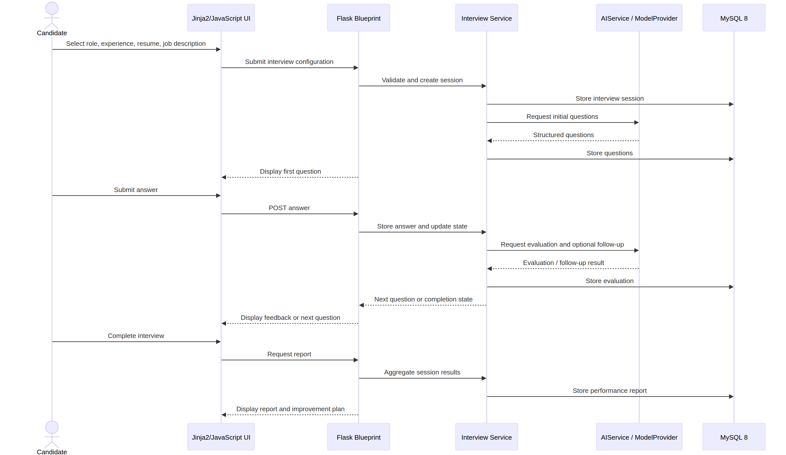
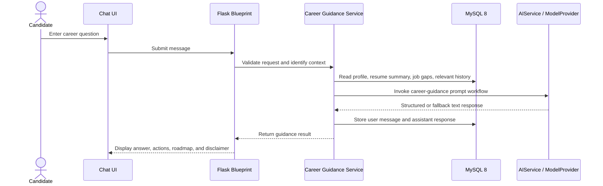
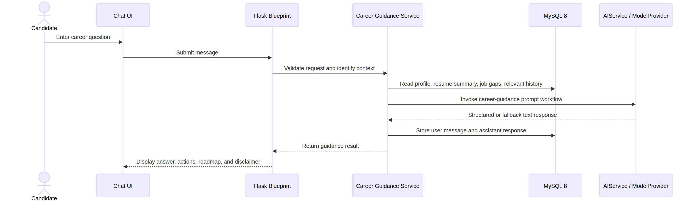
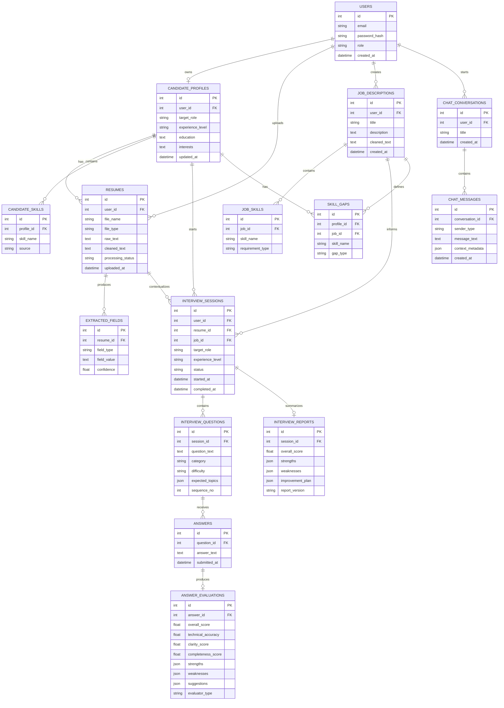
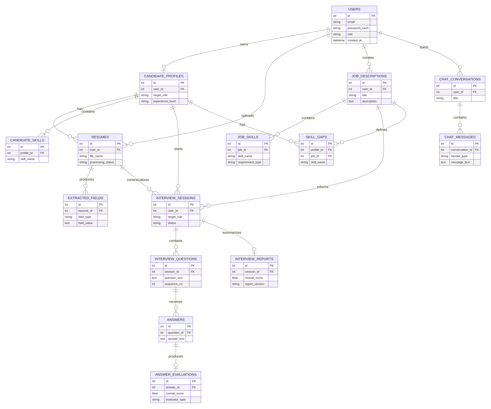

# Product Requirements Document (PRD)

## AI-Powered Mock Interview and Career Guidance Platform

**Document status:** Refined product and technical requirements document  
**Project type:** Existing academic and industrial-training software project  
**Primary users:** Candidates / students / job seekers  
**Product format:** Server-rendered web application with AI-assisted workflows  
**Implementation boundary:** Documented around the existing Flask, MySQL, and NVIDIA NIM-based application architecture

---

## 1. Executive Summary

The AI-Powered Mock Interview and Career Guidance Platform is an intelligent web application that helps candidates prepare for technical interviews and make informed career-development decisions. The platform combines candidate profile management, resume and job-description analysis, dynamic mock interview generation, answer submission and evaluation, performance reporting, interview history, and an integrated career guidance chatbot.

The platform provides two major experiences within one application:

1. **AI Mock Interview System:** The candidate selects a target role and experience level, optionally provides a resume and job description, receives dynamically generated interview questions, submits answers, receives follow-up questions where applicable, and obtains a structured performance report.
2. **Career Guidance Chatbot:** The candidate asks career-related questions and receives personalized guidance based on the candidate’s profile, resume, skills, experience, target role, job description, interview history, and relevant conversation context.

The chatbot is an integrated module of the platform. It is not a separate standalone product.

The system combines traditional web application engineering with Artificial Intelligence, Natural Language Processing, Machine Learning, Deep Learning research, and Large Language Model integration. The configured development AI model is NVIDIA-hosted model `nvidia/nemotron-3.5-bolt-e4b` through NVIDIA NIM. This is a development-environment configuration and must not be treated as a permanent or guaranteed model choice.

The product is an assistive career-preparation system. It does not guarantee interview success, make employment decisions, or replace a human mentor, recruiter, or interviewer.

---

## 2. Product Vision

Help candidates move from uncertainty to structured career preparation by turning their existing profile and target role into practical interview practice, understandable feedback, and a personalized development plan.

### 2.1 Candidate Journey

```text
Understand profile → Select target role → Analyze job requirements →
Practice interview → Receive feedback → Identify gaps →
Follow a learning roadmap → Practice again
```

### 2.2 Product Principles

1. **Personalized:** Use candidate context rather than returning generic advice.
2. **Actionable:** Convert feedback into specific next steps, skills, projects, or learning topics.
3. **Explainable:** Show why a score or recommendation was produced where possible.
4. **Supportive:** Feedback should be constructive, professional, and improvement-oriented.
5. **Human-centered:** AI assists preparation; it does not make employment or career decisions for the candidate.
6. **Modular:** Keep interview generation, evaluation, chatbot guidance, resume analysis, and persistence separable.
7. **Privacy-aware:** Candidate resumes, answers, chat history, and profile information are sensitive data.

---

## 3. Problem Statement

Traditional interview preparation commonly relies on generic question banks, manual evaluation, scattered learning resources, and informal advice. Candidates frequently experience:

- Difficulty finding role-specific technical interview questions.
- Lack of realistic interview practice.
- No immediate feedback on the quality of answers.
- Difficulty identifying weak technical or communication areas.
- Lack of structured performance analysis across interview attempts.
- Difficulty matching resume skills to job requirements.
- Uncertainty about suitable career paths and target roles.
- Lack of personalized learning roadmaps.
- Difficulty deciding which projects to build for a target role.
- Difficulty connecting interview feedback to long-term career development.

The platform addresses these problems by combining profile-aware resume and job analysis, AI-generated mock interviews, answer evaluation, structured reports, interview history, and a conversational career-guidance module.

---

## 4. Product Objectives

1. Develop a secure web-based interview-preparation platform.
2. Implement candidate registration, authentication, and profile management.
3. Allow candidates to upload and process resumes.
4. Extract useful information from resumes, including skills, education, experience, projects, and certifications where detectable.
5. Allow candidates to provide job descriptions for target-role analysis.
6. Generate role-specific interview questions dynamically using the existing LLM integration.
7. Support complete mock-interview sessions and answer submission.
8. Generate follow-up questions based on interview context and previous answers where supported.
9. Evaluate candidate answers through baseline and AI-assisted evaluation.
10. Generate structured interview performance reports.
11. Maintain interview history for progress tracking.
12. Implement an integrated career guidance chatbot.
13. Personalize chatbot responses using the candidate profile, resume, skills, experience, job description, and relevant conversation history.
14. Explore an experimental machine-learning answer-quality classification model.
15. Provide a scalable, modular, maintainable application architecture using the project’s actual technology stack.

---

## 5. Scope

### 5.1 In Scope

- Candidate registration, login, logout, and session-based authentication.
- Candidate profile creation and editing.
- Resume upload and text extraction.
- Resume preprocessing using text normalization, tokenization, TF-IDF, cosine similarity, and related Python NLP utilities.
- Job-description input and analysis.
- Candidate–job skill matching and gap identification to personalize preparation.
- Mock-interview setup by target role, experience level, resume, and optional job description.
- Dynamic question generation through the existing AI provider abstraction.
- Interview session creation and question sequencing.
- Text-based answer submission.
- Baseline answer-quality checks using deterministic features where implemented.
- AI-assisted answer evaluation through a separate evaluation prompt workflow.
- Follow-up question generation through a separate prompt workflow where supported.
- Structured interview-performance reports.
- Interview history and past-result viewing.
- Integrated career-guidance chatbot.
- Context-aware career guidance using candidate data and relevant chat history.
- Structured AI responses where supported by the provider and response parser.
- Server-rendered Jinja2 pages with Vanilla JavaScript and Bootstrap 5 interactions.
- MySQL 8 relational persistence through SQLAlchemy ORM.
- Schema versioning through Flask-Migrate and Alembic.
- Testing of authentication, parsing, interview flows, AI service boundaries, scoring, and persistence.

### 5.2 Out of Scope for the Current Project

- Video interview recording or facial-expression analysis.
- Real-time speech recognition or pronunciation scoring unless separately implemented.
- Automated hiring, rejection, or employment decisions.
- Guaranteed correctness of LLM responses.
- Production-grade multi-tenant enterprise deployment.
- External job-board or ATS integrations unless already present in the implementation.
- Training a large language model from scratch.
- Replacing the configured NVIDIA NIM provider with an unrelated AI stack.
- A React, Node.js, Express, Django, MongoDB, or Tailwind rewrite.
- Automatic claims that the experimental ML classifier is production-ready.

### 5.3 Future Scope

- Voice-based mock interviews with speech-to-text and text-to-speech.
- Video-based interview practice, subject to privacy and consent controls.
- Advanced semantic embeddings and retrieval over candidate resources.
- Retrieval-Augmented Generation for curated learning material.
- More robust answer-quality classification trained on a validated labeled dataset.
- Multilingual interview and guidance support.
- Mentor or recruiter review workflows.
- External job-portal and learning-platform integrations.
- Advanced progress analytics and cohort dashboards.
- Bias, safety, and hallucination evaluation dashboards.
- Containerized cloud deployment and horizontal scaling.

---

## 6. User Roles and Jobs-to-be-Done

### 6.1 Candidate

**Primary job-to-be-done:** “Help me prepare for a target role, understand how I am performing, and decide what to improve next.”

The candidate can:

- Register and authenticate.
- Maintain a profile and target role.
- Upload a resume.
- Provide a job description.
- Start a mock interview.
- Submit answers.
- Read feedback and performance reports.
- Review prior interview attempts.
- Ask career questions in the chatbot.
- Request skill-gap analysis, learning roadmaps, project recommendations, and interview-preparation guidance.

### 6.2 Application Administrator / Maintainer

The current academic prototype does not require a separate administrative dashboard. The application maintainer is responsible for configuration, database migrations, prompt templates, provider configuration, logging, and deployment. Administrative functionality can be expanded later.

### 6.3 AI Provider / External Inference Service

NVIDIA NIM acts as an external inference provider accessed through the application’s existing AIService and ModelProvider abstraction. It is not a human user and does not own application data.

---

## 7. End-to-End Product Workflow






### 7.1 Main User Journey

1. Candidate creates an account or signs in.
2. Candidate completes or updates a profile.
3. Candidate uploads a resume.
4. The system extracts and normalizes resume content.
5. Candidate optionally supplies a target job description.
6. The system identifies skills, requirements, and gaps.
7. Candidate starts either a mock interview or the career guidance chatbot.
8. AI features receive only the context required for the specific workflow.
9. The platform stores structured results and relevant history.
10. Candidate uses the results to guide the next preparation activity.

---

## 8. System Architecture






### 8.1 Architecture Responsibilities

| Layer / component | Responsibility |
|---|---|
| Flask application | Application startup, configuration, request lifecycle, error handling, and registration of blueprints |
| Flask Blueprints | Feature-level route organization such as authentication, profile, resume, interview, chatbot, and reports |
| Flask application factory | Creates configured application instances for development, testing, and deployment contexts |
| Jinja2 templates | Server-rendered HTML views and reusable page fragments |
| Bootstrap 5 and custom CSS | Responsive layout, form components, feedback cards, dashboards, and application styling |
| Vanilla JavaScript | Client-side validation, UI state, Fetch API requests, asynchronous answer submission, and chatbot interactions |
| Application services | Business workflows kept separate from route handlers |
| Resume/job analysis | Text extraction, cleaning, normalization, TF-IDF representation, cosine similarity, skill extraction, and gap analysis |
| Interview service | Interview configuration, question flow, answer storage, evaluation orchestration, and report aggregation |
| Career guidance service | Candidate-context assembly, prompt workflow selection, response validation, and chatbot history handling |
| AIService | Shared boundary for model calls, structured response handling, provider errors, and model configuration |
| ModelProvider | Provider abstraction that allows the application to call the configured NVIDIA NIM model without coupling every feature to transport details |
| SQLAlchemy ORM | Relational data access and entity mapping |
| MySQL 8 | Persistent storage for users, profiles, resumes, interviews, answers, reports, chats, and configuration metadata |
| Flask-Migrate/Alembic | Versioned database schema changes and reproducible migration history |

### 8.2 Flask Application Structure

A representative logical structure is:

```text
application/
├── app factory and configuration
├── extensions
│   ├── SQLAlchemy
│   └── migration support
├── blueprints
│   ├── authentication
│   ├── profile
│   ├── resume and job analysis
│   ├── mock interview
│   ├── career guidance chatbot
│   └── reports/history
├── models
├── services
│   ├── resume parser
│   ├── NLP/matching service
│   ├── interview service
│   ├── evaluation service
│   ├── career guidance service
│   └── AIService / ModelProvider
├── templates
├── static
│   ├── css
│   └── js
└── migrations
```

The exact directory names may vary in the implementation; the architectural requirement is separation of routing, templates, business services, AI integration, persistence, and migration concerns.

---

## 9. Technology Stack

The following stack is the implementation baseline for this project. The PRD does not reinterpret the application as a React SPA or replace its backend with another framework.

### 9.1 Backend

| Technology | Role |
|---|---|
| Python | Primary programming language for application logic, NLP utilities, model integration, and tests |
| Flask | Web framework for routes, request handling, sessions, templates, and application lifecycle |
| Flask Blueprints | Modular organization of feature routes and views |
| Flask Application Factory Pattern | Creates application instances with environment-specific configuration and testability |
| SQLAlchemy ORM | Maps Python models to relational MySQL tables and manages database access |
| Flask-Migrate | Flask integration for database schema migration workflows |
| Alembic | Migration engine used by Flask-Migrate to version schema changes |
| PyMySQL | Python MySQL database driver used by SQLAlchemy |

### 9.2 Frontend

| Technology | Role |
|---|---|
| HTML5 | Semantic page structure and forms |
| CSS3 | Layout, responsive behavior, visual states, and custom styling |
| Vanilla JavaScript | Client-side interactions without a frontend SPA framework |
| Jinja2 Templates | Server-rendered dynamic pages and reusable template components |
| Bootstrap 5 | Responsive layout, navigation, forms, cards, alerts, modals, and utility styles |
| Custom CSS | Product-specific visual treatment and overrides |
| Fetch API | Asynchronous communication for answer submission, chatbot messages, status updates, and interactive views |

### 9.3 Database

| Technology | Role |
|---|---|
| MySQL 8 | Relational persistence layer |
| SQLAlchemy ORM | Entity relationships, queries, transactions, and database abstraction |
| Flask-Migrate and Alembic | Version-controlled schema evolution |
| PyMySQL | MySQL connectivity from the Python application |

### 9.4 AI and LLM Integration

| Component | Role |
|---|---|
| NVIDIA NIM | Hosted inference interface for the configured NVIDIA model |
| NVIDIA-hosted LLM inference | Generates questions, follow-ups, evaluation outputs, and career guidance responses |
| AIService abstraction | Shared application-level service for invoking AI capabilities and normalizing responses |
| ModelProvider architecture | Separates features from a specific provider/model implementation |
| Structured AI responses | Encourages predictable fields for questions, evaluations, reports, and guidance |
| Prompt templates | Feature-specific instructions for consistent model behavior |
| Prompt registry | Central place for versioned prompt definitions and workflow selection |
| Configured development model | `nvidia/nemotron-3.5-bolt-e4b`; configuration may change by environment |

### 9.5 NLP

The platform uses Python NLP utilities for:

- Text extraction and cleanup.
- Whitespace and punctuation normalization.
- Tokenization.
- Stop-word and noise handling where implemented.
- Skill and keyword extraction.
- TF-IDF vectorization.
- Cosine-similarity calculations.
- Resume and job-description comparison.
- Preparation of concise context for AI prompts.

### 9.6 Machine Learning

Scikit-learn supports classical feature processing and similarity calculations. The project may also include an experimental answer-quality classification model using engineered text features. This classifier must be documented as experimental unless it has been trained, validated, and evaluated on an appropriate labeled dataset.

### 9.7 Deep Learning and Generative AI Boundary

The project demonstrates practical use of generative AI through NVIDIA-hosted LLM inference. Deep-learning research is represented through the use and evaluation of an external pretrained model rather than training a foundation model from scratch. Any experimental answer classifier must not be described as equivalent to the LLM evaluator.

---

## 10. AI Service and Prompt Architecture

### 10.1 Shared AIService Boundary

All LLM-backed features should call the existing `AIService` abstraction rather than making provider-specific requests from individual route handlers. The service is responsible for:

- Selecting the configured model/provider.
- Accepting a feature workflow and context payload.
- Loading the appropriate prompt template from the prompt registry.
- Sending a request to NVIDIA NIM.
- Parsing structured output where required.
- Validating required response fields.
- Handling timeouts, provider failures, malformed output, and retries according to project configuration.
- Returning a consistent application-level result to the calling service.

### 10.2 ModelProvider Architecture

The `ModelProvider` abstraction isolates provider-specific details such as request format, endpoint configuration, authentication, model name, and response parsing. This allows the application to change a development model or provider configuration without rewriting interview and chatbot business logic.

The configured development model is:

```text
nvidia/nemotron-3.5-bolt-e4b
```

This should be represented as environment/configuration data and not hard-coded as an immutable product promise.

### 10.3 Separate AI Workflows

The platform must keep the following workflows conceptually and operationally distinct:

| Workflow | Input context | Output |
|---|---|---|
| Initial question generation | Target role, experience level, resume summary, job description, interview type, difficulty | Structured interview questions with topic/difficulty metadata |
| Follow-up generation | Current question, candidate answer, interview context, prior questions/answers | One or more relevant follow-up questions |
| Answer evaluation | Question, candidate answer, expected topic/rubric, role context, optional resume/job context | Structured evaluation with scores, strengths, weaknesses, and improvement suggestions |
| Career guidance | User query, profile, resume summary, skills, experience, target role, job description, relevant chat history | Personalized career guidance response, optionally structured as actions/roadmap/projects |

A chatbot prompt must not be reused as an answer-evaluation prompt, and an evaluation prompt must not be used to generate questions. Separate prompts improve control, testing, and maintainability.

### 10.4 Structured Response Contracts

#### Question Generation Response

```json
{
  "questions": [
    {
      "text": "string",
      "category": "technical|behavioral|project|role-specific",
      "difficulty": "beginner|intermediate|advanced",
      "expected_topics": ["string"]
    }
  ]
}
```

#### Answer Evaluation Response

```json
{
  "overall_score": 0,
  "technical_accuracy": 0,
  "clarity": 0,
  "completeness": 0,
  "relevance": 0,
  "strengths": ["string"],
  "weaknesses": ["string"],
  "improvement_suggestions": ["string"],
  "summary": "string"
}
```

#### Career Guidance Response

```json
{
  "answer": "string",
  "recommended_actions": ["string"],
  "skills_to_build": ["string"],
  "projects_to_consider": ["string"],
  "roadmap": [
    {
      "phase": "string",
      "goals": ["string"]
    }
  ],
  "disclaimer": "string"
}
```

The application must tolerate provider responses that cannot be parsed into the preferred structure. In that case, it should preserve a safe fallback text response, log the parsing issue, and avoid presenting fabricated structured fields.

---

## 11. Functional Requirements

### 11.1 Authentication and Profile

| ID | Requirement | Priority |
|---|---|---:|
| FR-AUTH-01 | The system shall allow a candidate to register with required account information. | P0 |
| FR-AUTH-02 | The system shall authenticate registered candidates and maintain a session. | P0 |
| FR-AUTH-03 | The system shall support logout and session termination. | P0 |
| FR-AUTH-04 | The system shall restrict candidate-specific data to the authenticated owner. | P0 |
| FR-PROF-01 | The candidate shall be able to create and update a profile. | P0 |
| FR-PROF-02 | The profile shall support target role, experience level, skills, education, and career interests. | P0 |
| FR-PROF-03 | The system shall retain profile data for personalization. | P0 |

### 11.2 Resume and Job Analysis

| ID | Requirement | Priority |
|---|---|---:|
| FR-DOC-01 | The candidate shall be able to upload a supported resume file. | P0 |
| FR-DOC-02 | The system shall extract text from the uploaded resume. | P0 |
| FR-DOC-03 | The system shall preprocess resume text using the project’s NLP utilities. | P0 |
| FR-DOC-04 | The system shall extract best-effort fields such as skills, education, experience, projects, and certifications. | P0 |
| FR-DOC-05 | The candidate shall be able to provide a job description as text or supported input. | P0 |
| FR-DOC-06 | The system shall identify job skills and requirements where detectable. | P0 |
| FR-DOC-07 | The system shall calculate text similarity using TF-IDF and cosine similarity where applicable. | P0 |
| FR-DOC-08 | The system shall display skill matches and skill gaps to support interview preparation. | P0 |

### 11.3 Mock Interview Setup

| ID | Requirement | Priority |
|---|---|---:|
| FR-INT-01 | The candidate shall be able to start a mock interview. | P0 |
| FR-INT-02 | The candidate shall be able to select or enter a target role. | P0 |
| FR-INT-03 | The candidate shall be able to select an experience level. | P0 |
| FR-INT-04 | The candidate shall be able to use an uploaded resume as interview context. | P0 |
| FR-INT-05 | The candidate shall be able to use an optional job description as interview context. | P0 |
| FR-INT-06 | The candidate shall be able to select an interview type or topic where supported. | P1 |
| FR-INT-07 | The system shall display the interview configuration before question generation. | P0 |

### 11.4 Question Generation and Interview Session

| ID | Requirement | Priority |
|---|---|---:|
| FR-Q-01 | The system shall generate role-relevant initial questions through the AIService. | P0 |
| FR-Q-02 | The system shall use a dedicated question-generation prompt workflow. | P0 |
| FR-Q-03 | The system shall store generated questions with the interview session. | P0 |
| FR-Q-04 | The candidate shall be able to view one question at a time or according to the implemented session UI. | P0 |
| FR-Q-05 | The candidate shall be able to submit an answer for the current question. | P0 |
| FR-Q-06 | The system shall prevent an empty answer from being silently treated as a valid response. | P0 |
| FR-Q-07 | The system shall generate contextual follow-up questions where the feature is enabled. | P1 |
| FR-Q-08 | Follow-up questions shall use a separate follow-up prompt workflow. | P0 |
| FR-Q-09 | The system shall allow the candidate to complete or exit a session. | P0 |

### 11.5 Answer Evaluation and Performance Report

| ID | Requirement | Priority |
|---|---|---:|
| FR-EVAL-01 | The system shall evaluate submitted answers using the implemented baseline and/or AI-assisted evaluation path. | P0 |
| FR-EVAL-02 | The AI evaluation path shall use a dedicated evaluation prompt workflow. | P0 |
| FR-EVAL-03 | The system shall store the submitted answer and evaluation result. | P0 |
| FR-EVAL-04 | The system shall report strengths and weaknesses for an answer or session. | P0 |
| FR-EVAL-05 | The system shall provide improvement suggestions. | P0 |
| FR-EVAL-06 | The system shall aggregate answer-level results into a session-level report. | P0 |
| FR-EVAL-07 | The report shall distinguish AI-generated feedback from deterministic metrics where both exist. | P0 |
| FR-EVAL-08 | The experimental ML answer-quality classifier shall be clearly labeled as experimental. | P0 |
| FR-EVAL-09 | The system shall retain an interview history entry after session completion. | P0 |

### 11.6 Career Guidance Chatbot

| ID | Requirement | Priority |
|---|---|---:|
| FR-CHAT-01 | The candidate shall be able to open the career-guidance chatbot within the platform. | P0 |
| FR-CHAT-02 | The candidate shall be able to submit a career-related question. | P0 |
| FR-CHAT-03 | The system shall assemble relevant candidate context before invoking the chatbot workflow. | P0 |
| FR-CHAT-04 | The chatbot shall use a dedicated career-guidance prompt workflow. | P0 |
| FR-CHAT-05 | The system shall use relevant conversation history without exposing unrelated users’ data. | P0 |
| FR-CHAT-06 | The chatbot shall support career exploration, skill-gap analysis, learning roadmaps, project recommendations, interview preparation, and career-related questions. | P0 |
| FR-CHAT-07 | The system shall display a clear limitation that guidance is AI-assisted and should be validated by the candidate or a human mentor. | P0 |
| FR-CHAT-08 | The system shall persist relevant chat messages and timestamps. | P1 |
| FR-CHAT-09 | The system shall handle provider failure with a clear, non-fabricated error state. | P0 |

### 11.7 History and Reporting

| ID | Requirement | Priority |
|---|---|---:|
| FR-HIST-01 | The candidate shall be able to view prior interview sessions. | P0 |
| FR-HIST-02 | The candidate shall be able to open a prior performance report. | P0 |
| FR-HIST-03 | The system shall show interview date, target role, score summary, and completion status. | P0 |
| FR-HIST-04 | The system shall preserve sufficient metadata to explain how a result was generated. | P1 |
| FR-HIST-05 | The candidate shall be able to distinguish current-session results from historical results. | P1 |

---

## 12. Interview Workflow Specification

### 12.1 Interview State Model

```text
DRAFT → CONFIGURED → QUESTIONS_GENERATED → IN_PROGRESS →
ANSWER_SUBMITTED → EVALUATED → COMPLETED

Possible exception states:
CONFIGURATION_ERROR, AI_PROVIDER_ERROR, EVALUATION_ERROR, ABANDONED
```

### 12.2 Mock Interview Sequence






### 12.3 Interview Question Rules

- Questions must be relevant to the target role and experience level.
- Resume and job-description context should be used only when available and appropriate.
- Generated questions should be stored so the completed session is reproducible.
- The system should avoid generating duplicate questions within the same session where practical.
- The UI should identify whether a question is technical, behavioral, project-based, or role-specific when that metadata is available.
- If the LLM fails, the system should show a recoverable error or use an implemented baseline fallback; it must not invent a claim that generation succeeded.

### 12.4 Answer Submission Rules

- The candidate must be able to submit text answers through the web UI.
- Empty or whitespace-only answers should be rejected or explicitly recorded as skipped.
- The answer must be associated with the question and interview session.
- Submission state should protect against accidental duplicate requests where feasible.
- The candidate should see a processing state while evaluation is in progress.

---

## 13. Answer Evaluation Specification

### 13.1 Baseline Evaluation

The baseline path may use deterministic or classical ML features available in the implementation, such as:

- Answer length and completeness indicators.
- Keyword/topic overlap with expected topics.
- TF-IDF and cosine similarity between the answer and expected-topic text.
- Scikit-learn feature extraction and experimental classification where implemented.

Baseline outputs must be described as measurable indicators, not as a complete assessment of a candidate’s intelligence or employability.

### 13.2 AI-Assisted Evaluation

The AI evaluator receives the current question, candidate answer, expected topics or rubric, and relevant role context. It returns structured feedback such as:

- Overall answer score.
- Technical accuracy.
- Relevance.
- Clarity.
- Completeness.
- Strengths.
- Weaknesses.
- Suggested improvement.
- Short explanation.

### 13.3 Report Aggregation

The session report should include:

- Overall session score or summary.
- Scores by evaluation dimension where available.
- Questions attempted and unanswered.
- Strongest areas.
- Weakest areas.
- Repeated weaknesses or missing topics.
- Suggested preparation actions.
- Relevant resume/job skill gaps.
- A clear statement that feedback is AI-assisted and should be interpreted as guidance.

### 13.4 ML Classifier Boundary

The experimental answer-quality classification model is separate from the generative LLM evaluator. The PRD must document:

- Input features.
- Training or sample-data limitations.
- Label definitions, if available.
- Evaluation metrics, if measured.
- Known risks of class imbalance and dataset bias.
- The fact that an experimental score must not be used for employment decisions.

---

## 14. Career Guidance Chatbot Specification

### 14.1 Context Assembly

Before calling the career-guidance workflow, the service may assemble:

- Candidate profile fields.
- Target role and experience level.
- Extracted resume skills, education, projects, certifications, and experience.
- Job-description requirements and skill gaps.
- Recent interview performance summary.
- Relevant recent conversation history.
- The candidate’s current question.

The context should be limited to what is relevant to the request to reduce noise, prompt size, privacy exposure, and unintended model behavior.

### 14.2 Supported Guidance Intents

The chatbot should be able to support:

- Career-path exploration.
- Role comparison.
- Resume and skill interpretation.
- Skill-gap analysis.
- Learning-roadmap planning.
- Project recommendations.
- Interview-preparation advice.
- Explanation of interview feedback.
- Questions about improving technical or communication skills.

### 14.3 Chatbot Response Rules

- Responses should be personalized but not overconfident.
- Recommendations should be presented as suggestions, not guarantees.
- The chatbot should acknowledge missing information rather than fabricate candidate history.
- The chatbot should not expose internal prompts, provider secrets, or other users’ records.
- High-impact decisions such as employment, legal, medical, or financial decisions should receive an appropriate limitation notice.
- Provider failure, timeout, or malformed output must produce a clear fallback state.

### 14.4 Chatbot Sequence






---

## 15. Resume and Job Analysis

### 15.1 Resume Pipeline

1. Validate file type and size.
2. Extract text from the supported document format.
3. Normalize whitespace, punctuation, and casing.
4. Tokenize text.
5. Remove irrelevant noise where implemented.
6. Identify sections and candidate fields.
7. Extract skills using the project’s matching utilities or taxonomy.
8. Extract education, experience, projects, and certifications where detectable.
9. Store raw text, cleaned text, extracted fields, and processing status.
10. Use the resulting summary as optional context for interviews and career guidance.

### 15.2 Job-Description Pipeline

1. Accept job-description input.
2. Clean and normalize text.
3. Tokenize and create TF-IDF representation where required.
4. Identify required and preferred skills.
5. Identify experience and education requirements where detectable.
6. Compare job requirements with the candidate profile.
7. Display matched and missing skills.
8. Use the analysis as optional context for interview generation and guidance.

### 15.3 Matching and Similarity

```text
Text Similarity = cosine_similarity(TFIDF(candidate_text), TFIDF(job_text))

Missing Skills = Required Job Skills − Candidate Extracted Skills
```

The matching result supports preparation and personalization. It is not an employment decision.

---

## 16. Data Model






### 16.1 Entity Responsibilities

| Entity | Purpose |
|---|---|
| Users | Authentication identity and ownership boundary |
| Candidate Profiles | Candidate preferences, target role, experience, and personalization data |
| Resumes | Uploaded documents, extracted text, and processing metadata |
| Extracted Fields | Structured fields produced by resume processing |
| Job Descriptions | Candidate-provided target job context |
| Job Skills | Required and preferred skills extracted from a job description |
| Candidate Skills | Candidate skills and their source |
| Skill Gaps | Differences between candidate capabilities and target job requirements |
| Interview Sessions | One configured mock-interview attempt |
| Interview Questions | Initial and follow-up questions belonging to a session |
| Answers | Candidate responses to interview questions |
| Answer Evaluations | Baseline and/or AI-generated answer feedback |
| Interview Reports | Aggregated session-level performance report |
| Chat Conversations | A candidate’s chatbot thread |
| Chat Messages | User and assistant messages plus relevant metadata |

### 16.2 Data and AI Metadata

Where practical, AI-generated records should retain:

- Prompt workflow identifier.
- Prompt or report version.
- Provider/model identifier.
- Timestamp.
- Structured parsing status.
- Session and user association.
- Whether the result was generated by a baseline, classifier, LLM, or combined path.

Secrets, API keys, and raw authorization headers must never be stored in ordinary application records.

---

## 17. Application Routes and Service Interfaces

The exact route names may vary, but the application should provide logical equivalents to the following capabilities.

| Area | Example route/capability | Purpose |
|---|---|---|
| Authentication | `/register`, `/login`, `/logout` | Account and session management |
| Profile | `/profile`, `/profile/edit` | View and update candidate profile |
| Resume | `/resume/upload`, `/resume/{id}` | Upload, process, and inspect resume |
| Job analysis | `/job-description`, `/job-description/analyze` | Enter and analyze a target job |
| Interview setup | `/interview/new` | Configure a mock interview |
| Interview session | `/interview/{id}` | Display question and collect answer |
| Answer submission | `/interview/{id}/answer` | Store answer and invoke evaluation/follow-up flow |
| Interview report | `/interview/{id}/report` | Show aggregated performance report |
| History | `/interview/history` | List previous sessions |
| Chatbot | `/career-guidance`, `/career-guidance/message` | Display and submit career guidance messages |

### 17.1 Service Boundaries

- Route handlers validate input and delegate business logic.
- Services orchestrate workflows and transactions.
- AIService owns provider communication and response normalization.
- Models define persistence and relationships.
- Templates render state; JavaScript enhances interaction but does not replace the server-rendered application.

---

## 18. User Interface Requirements

### 18.1 Authentication Screens

- Registration form with clear validation.
- Login form with authentication errors that do not reveal sensitive account details.
- Logout action and session-expiration handling.

### 18.2 Candidate Dashboard

The dashboard should provide access to:

- Profile completion and target-role summary.
- Resume processing status.
- Job-description analysis and skill gaps.
- Start-interview action.
- Recent interview results.
- Career Guidance Chatbot.
- Recommended next actions.

### 18.3 Interview Setup Screen

- Target role input or selection.
- Experience-level selection.
- Resume selection.
- Optional job-description selection/input.
- Interview topic/type and difficulty where supported.
- Explanation of AI-assisted feedback.
- Start confirmation.

### 18.4 Interview Screen

- Current question.
- Question category and sequence where available.
- Answer text area.
- Submit/continue action.
- Processing state after submission.
- Exit or save-progress behavior according to implementation.
- Clear distinction between question generation, evaluation, and follow-up states.

### 18.5 Interview Report Screen

- Overall session score or summary.
- Dimension-level scores where available.
- Question-by-question feedback.
- Strengths.
- Weaknesses.
- Improvement suggestions.
- Skill gaps connected to the target role.
- Recommended next preparation steps.
- AI-generated feedback disclaimer.

### 18.6 Career Guidance Chatbot Screen

- Conversation history.
- Message composer.
- Loading and error states.
- Structured response sections for actions, skills, projects, and roadmap when available.
- Context and privacy notice.
- Clear AI-guidance disclaimer.

### 18.7 Accessibility and Usability

- Use semantic HTML and accessible form labels.
- Ensure keyboard-accessible controls.
- Use visible focus states.
- Do not rely on color alone for scores or status.
- Provide readable error messages and recovery actions.
- Use responsive Bootstrap layouts for common screen sizes.

---

## 19. Non-Functional Requirements

| Category | Requirement |
|---|---|
| Security | Passwords must be stored using secure hashing; sessions and authorization must be protected; secrets must come from configuration/environment management |
| Privacy | Resume text, answers, reports, and chat history must be treated as sensitive candidate data |
| Reliability | Provider failures, parser errors, malformed responses, and database failures should return controlled error states |
| Performance | Normal page loads and database operations should be responsive; AI latency should be represented with a processing state |
| Maintainability | Use Flask Blueprints, application services, models, templates, and AI abstractions with clear responsibilities |
| Testability | Application factory and service boundaries should support isolated unit and integration tests |
| Data integrity | Use relational constraints, transactions, migrations, and ownership checks |
| Explainability | Reports should separate deterministic metrics from AI-generated feedback |
| Reproducibility | Store session configuration, prompt workflow/version, provider/model identifier, and result timestamps where practical |
| Scalability | Keep provider, service, and persistence boundaries modular for future deployment improvements |
| Usability | Candidate workflows should be understandable without technical training |
| Accessibility | Forms, feedback, dashboards, and chatbot views should support accessible interaction patterns |

---

## 20. Security, Privacy, and Responsible AI

### 20.1 Application Security

- Hash passwords; never store plaintext passwords.
- Validate uploaded file type and size.
- Sanitize filenames and store files safely.
- Protect routes by authentication and ownership.
- Use CSRF protection where applicable to the Flask form/session setup.
- Escape user-generated text in templates.
- Keep NVIDIA/API secrets outside source control.
- Avoid logging complete resumes, answers, tokens, or sensitive chat content unnecessarily.
- Use parameterized ORM/database access.
- Apply secure session configuration.

### 20.2 AI Safety and Quality

- Treat LLM outputs as probabilistic and fallible.
- Validate structured output before storing or rendering it.
- Do not fabricate scores or fields when generation fails.
- Display AI-assisted feedback disclaimers.
- Keep prompts versioned and reviewable.
- Prevent prompt context from including unrelated users’ data.
- Evaluate outputs for relevance, unsafe advice, and hallucinations during testing.
- Do not use interview scores as automatic employment decisions.

### 20.3 Data Lifecycle

Before production deployment, define:

- Resume retention period.
- Chat and answer-history retention period.
- Candidate deletion/export behavior.
- Whether AI-provider requests are retained by the provider.
- Consent and disclosure for sending candidate content to external inference.

---

## 21. Testing Strategy

### 21.1 Unit Testing

Test individual functions and services for:

- Password hashing and authentication helpers.
- Resume text extraction and cleanup.
- Tokenization, normalization, and TF-IDF preparation.
- Cosine similarity and skill-gap calculations.
- Interview state transitions.
- Question and answer validation.
- Score aggregation.
- Structured AI-response parsing.
- Chat context assembly.
- Prompt-workflow selection.

### 21.2 Integration Testing

Test:

- Flask application factory initialization.
- Blueprint route registration.
- MySQL/SQLAlchemy persistence.
- Flask-Migrate/Alembic migration execution.
- Authentication-to-profile flow.
- Resume upload-to-profile flow.
- Interview creation-to-report flow.
- Chat message-to-response persistence flow.
- AIService-to-provider adapter using mocked provider responses.

### 21.3 End-to-End Testing

Representative scenarios:

1. Register, log in, complete profile, and log out.
2. Upload a valid resume and inspect extracted fields.
3. Submit an unreadable or unsupported file and verify a recoverable error.
4. Analyze a target job and view skill gaps.
5. Start an interview using role and resume context.
6. Submit a valid answer and receive evaluation.
7. Trigger a follow-up question.
8. Complete an interview and open the performance report.
9. Open interview history and view an earlier report.
10. Ask the chatbot for a learning roadmap based on a target role.
11. Simulate an AI provider timeout and verify a safe error state.
12. Confirm one candidate cannot access another candidate’s data.

### 21.4 AI Evaluation Testing

Evaluate with a representative test set for:

- Question relevance.
- Difficulty alignment.
- Follow-up relevance.
- Feedback usefulness.
- Structured-output validity.
- Chatbot personalization.
- Hallucination and unsupported-claim rate.
- Latency and failure handling.

Human review is required for meaningful quality claims. A small demonstration dataset is not sufficient to claim production-level model accuracy.

### 21.5 Experimental Classifier Evaluation

If the answer-quality classifier is implemented, document:

- Dataset size and source.
- Labeling procedure.
- Train/validation/test split.
- Accuracy, precision, recall, F1, and confusion matrix where appropriate.
- Class imbalance.
- Feature leakage risks.
- Generalization limitations.

---

## 22. Error Handling and Recovery

| Condition | Expected behavior |
|---|---|
| Invalid credentials | Show a general authentication error and do not reveal account existence unnecessarily |
| Unauthorized record access | Return an authorization failure without exposing the record |
| Unsupported resume | Reject with supported-format guidance |
| Empty/unreadable resume | Mark processing failure and request another document |
| Empty answer | Ask the candidate to provide an answer or explicitly skip |
| AI timeout | Show a retryable provider error and preserve the session state |
| Malformed AI JSON | Attempt safe fallback parsing; do not create fabricated structured data |
| Database failure | Roll back transaction where possible and show a non-sensitive error |
| Session expiry | Redirect to login while preserving no sensitive unsaved content in the URL |
| Missing candidate context | Generate a general response while stating that personalization is limited |
| Unsafe or overconfident guidance | Apply response safeguards and show a limitation notice |

---

## 23. Risks and Limitations

| Risk / limitation | Impact | Mitigation |
|---|---|---|
| Resume extraction varies by document structure | Candidate context may be incomplete | Show best-effort status and allow profile correction |
| TF-IDF is lexical | Similar meaning with different wording may be missed | Treat matching as support; consider embeddings in future scope |
| LLM output variability | Questions or feedback may be inconsistent | Use prompt registry, structured responses, validation, and versioning |
| LLM hallucination | Incorrect career advice or evaluation | Disclaimers, context limits, human review, and output testing |
| Provider availability/cost/latency | Interview and chatbot experiences may be interrupted | Clear loading/error states and provider abstraction |
| Experimental ML model | Accuracy may not generalize | Label experimental and report dataset/metric limitations |
| Sensitive candidate data | Privacy or security exposure | Authentication, ownership checks, secure storage, and retention policy |
| Over-reliance on scores | Candidate may misinterpret feedback as objective truth | Explain limitations and present actionable qualitative feedback |
| Prompt injection through uploaded text | Model may follow malicious instructions inside documents | Delimit untrusted content and test prompt-injection defenses |
| Small academic validation set | Claims may not generalize | Use careful wording and expand validation before production |

---

## 24. Delivery and Maintenance Plan

### Phase 1 — Application Foundation

- Flask application factory.
- Configuration and environment management.
- Blueprint registration.
- MySQL connection through SQLAlchemy and PyMySQL.
- Flask-Migrate/Alembic baseline.
- Authentication and profile foundations.

### Phase 2 — Candidate Context

- Profile management.
- Resume upload and text extraction.
- NLP preprocessing and structured field extraction.
- Job-description input and skill-gap analysis.

### Phase 3 — AI Service Integration

- AIService abstraction.
- ModelProvider implementation for NVIDIA NIM.
- Configuration for development model `nvidia/nemotron-3.5-bolt-e4b`.
- Prompt registry and structured response parsing.
- Provider timeout and error handling.

### Phase 4 — Mock Interviews

- Interview setup.
- Session and question persistence.
- Initial question generation.
- Answer submission.
- Follow-up generation.
- Answer evaluation.
- Session report and history.

### Phase 5 — Career Guidance

- Chat conversation and message persistence.
- Candidate-context assembly.
- Career-guidance prompt workflow.
- Structured roadmap/project/action rendering.
- Chatbot failure and safety handling.

### Phase 6 — Validation and Documentation

- Unit, integration, and end-to-end tests.
- AI output evaluation.
- Security and privacy review.
- Migration verification.
- Academic documentation, diagrams, and demonstration scenarios.

### Maintenance Requirements

- Version prompts and report schemas.
- Record model/provider configuration changes.
- Maintain migrations in source control.
- Add regression tests for every critical workflow change.
- Review AI outputs when changing prompts or models.
- Keep README and environment setup instructions aligned with the actual stack.

---

## 25. Acceptance Criteria

### Account and Profile

- A new candidate can register and log in.
- An authenticated candidate can update their profile.
- An unauthenticated user cannot access protected candidate data.

### Resume and Job Analysis

- A supported resume can be uploaded and processed.
- Extracted text and fields are stored with processing status.
- A target job description can be analyzed.
- The candidate can view matched and missing skills.

### Mock Interview

- The candidate can configure a session by role and experience level.
- Resume and job context can be included when available.
- The system generates and stores relevant initial questions through the AIService.
- The candidate can submit answers.
- The system evaluates answers through the implemented evaluation path.
- Follow-up questions are generated through the separate follow-up workflow when enabled.
- The completed session produces a structured report.
- The session appears in interview history.

### Career Guidance Chatbot

- The candidate can open the chatbot and submit a question.
- The system uses relevant candidate context for personalization.
- The response is produced through the separate career-guidance workflow.
- The response can provide actions, skills, projects, or roadmap guidance where structured output is available.
- Chat messages are stored according to the project’s persistence design.
- Provider failure produces a controlled error rather than fabricated advice.

### AI and Responsible Use

- The configured development model is represented as configuration.
- Prompt workflows are separated by feature.
- AI-generated results are distinguishable from baseline/classifier metrics.
- The platform does not automatically make employment decisions.
- Limitations and AI-assisted nature are visible to the candidate.

---

## 26. Definition of Done

The refined project documentation is complete when:

- The PRD accurately describes the AI Mock Interview and Career Guidance Platform.
- The document uses Flask, Blueprints, the application factory pattern, SQLAlchemy, Flask-Migrate/Alembic, PyMySQL, MySQL 8, Jinja2, Bootstrap 5, custom CSS, Vanilla JavaScript, and Fetch API as the implementation stack.
- The architecture includes the existing AIService and ModelProvider abstractions.
- NVIDIA NIM and `nvidia/nemotron-3.5-bolt-e4b` are documented as the configured development integration/model rather than a permanent guarantee.
- Interview question generation, follow-up generation, answer evaluation, and chatbot guidance have separate prompt workflows.
- Resume/job NLP, interview sessions, evaluations, reports, chatbot conversations, history, database entities, testing, limitations, and future scope are documented.
- The diagrams correspond to the revised product rather than the previous resume-screening-only product.
- The final Markdown and PDF have been rendered and visually checked.

---

## Appendix A — Diagram Traceability

| PRD diagram | Purpose |
|---|---|
| End-to-end product flow | Shows the candidate journey from profile and resume context through interview practice or chatbot guidance |
| System architecture | Shows Flask, Blueprints, Jinja2/JavaScript frontend, application services, AIService, ModelProvider, NVIDIA NIM, MySQL, and migrations |
| Mock interview sequence | Shows setup, question generation, answer submission, evaluation, follow-up, and reporting |
| Career guidance sequence | Shows context assembly, chatbot prompt workflow, response persistence, and UI rendering |
| Data model ERD | Shows users, profiles, resumes, jobs, interviews, questions, answers, evaluations, reports, and chat entities |

## Appendix B — Implementation Boundary

This PRD describes an existing academic and industrial-training project. It intentionally does not redesign the application around React, Node.js, Express, Django, MongoDB, Tailwind, or a new unrelated AI provider. Future enhancements are identified separately and should not be presented as already implemented.
